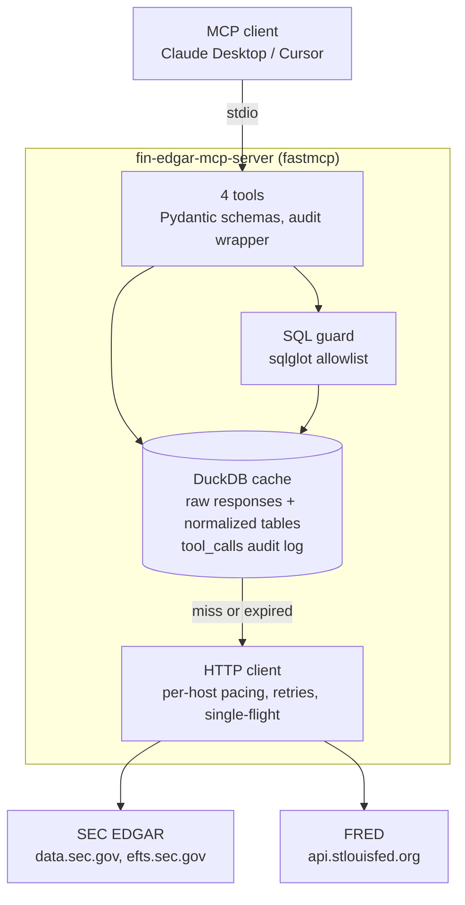

# fin-edgar-mcp-server

An [MCP](https://modelcontextprotocol.io) server that gives Claude Desktop, Cursor or any MCP client
**typed, cached, rate-limited access to SEC EDGAR filings, XBRL financials and FRED macro data**, plus
read-only SQL over its local cache.

Every number it returns carries its source: the filing's accession number, the XBRL concept it was
tagged with, the period, the unit and the URL. Missing data comes back as an explicit
`missing_metrics` entry, never a guess.

```
You:    What were Apple's revenue and net income for the last 3 fiscal years? Cite the filings.
Claude: (calls get_company_financials) and answers with each figure next to its 10-K accession number
        and a link to the filing.
```

## Tools

| Tool | What it does | Source |
| --- | --- | --- |
| `get_company_financials` | Revenue, net income, operating income, diluted EPS, assets, liabilities, equity, cash and operating cash flow, annual or quarterly, each value with its filing | EDGAR XBRL company facts |
| `search_sec_filings` | Filings by company, form type and date range, or EDGAR full-text search across all filers | EDGAR submissions and full-text search |
| `get_macro_indicator` | Any FRED series (CPI, unemployment, Treasury yields, GDP...) with metadata, optional downsampling | FRED API |
| `run_readonly_sql` | One DuckDB `SELECT` over the cached tables, with row cap and 5 s timeout | Local cache |

The resource `schema://tables` describes the queryable tables, so the model can read it before writing SQL.

## Quick start

Requires Python 3.11+ and [uv](https://docs.astral.sh/uv/).

```bash
git clone https://github.com/<your-account>/fin-edgar-mcp-server.git
cd fin-edgar-mcp-server
uv sync
cp .env.example .env   # then fill in the two values below
```

| Variable | Required | Purpose |
| --- | --- | --- |
| `EDGAR_USER_AGENT` | Yes, for SEC tools | The SEC asks every client to identify itself with a name and contact, e.g. `fin-edgar-mcp-server/0.1 Jane Doe jane@example.com`. Use your own details. |
| `FRED_API_KEY` | For `get_macro_indicator` | Free key from [fred.stlouisfed.org](https://fred.stlouisfed.org/docs/api/api_key.html). The SEC tools work without it. |
| `FIN_MCP_CACHE_PATH` | No | Cache file location. Default `~/.cache/fin-edgar-mcp/cache.duckdb`. |
| `FIN_MCP_LOG_LEVEL` | No | Default `INFO`. Logs go to stderr as JSON lines. |

### Claude Desktop

Open **Settings → Developer → Edit Config** and add this to `claude_desktop_config.json`, with the
absolute path to your clone:

```json
{
  "mcpServers": {
    "fin-edgar": {
      "command": "uv",
      "args": ["--directory", "/absolute/path/to/fin-edgar-mcp-server", "run", "fin-edgar-mcp"],
      "env": {
        "EDGAR_USER_AGENT": "fin-edgar-mcp-server/0.1 Your Name you@example.com",
        "FRED_API_KEY": "your-fred-api-key"
      }
    }
  }
}
```

Restart Claude Desktop. The four tools appear under the tools icon.

### Cursor

Add the same block under `mcpServers` in `~/.cursor/mcp.json`.

### Docker

```bash
docker build -t fin-edgar-mcp .
docker run -i --rm -e EDGAR_USER_AGENT="..." -e FRED_API_KEY="..." \
  -v fin-edgar-cache:/data fin-edgar-mcp
```

For Claude Desktop, use `"command": "docker"` with those arguments in `args`.

### Try it

- "Pull Microsoft's quarterly revenue and operating income for the last 2 years."
- "List Tesla's 8-K filings from 2024."
- "Find 10-K filings that mention 'going concern' and 'material weakness' since 2023."
- "Plot US CPI and the fed funds rate since 2019."
- "Using SQL over the cache, compute Apple's net margin by fiscal year."

## Architecture



```
src/fin_edgar_mcp/
  server.py      MCP wiring: tools, schema resource, audit log, error mapping, stdio entry point
  services.py    Tool logic, independent of MCP
  financials.py  XBRL normalization rules (pure functions)
  edgar.py       Ticker lookup, submissions, company facts, full-text search
  fred.py        Series metadata, observations, aliases
  http.py        Cached, paced, retrying HTTP client with stale fallback
  cache.py       DuckDB schema, cache, audit log, read-only query execution
  sql_guard.py   Parser-level SQL allowlist
  ratelimit.py   Strict-spacing per-host limiter
  models.py      Pydantic output models
  errors.py      Typed error codes
```

## How it avoids wrong numbers

XBRL data is messy. The normalizer in [`financials.py`](src/fin_edgar_mcp/financials.py) handles the
common traps explicitly, and each rule has a test:

- **Companies change tags.** Each metric maps to an ordered list of concepts (revenue alone has at least
  three common tags). Per period, the highest-priority concept wins, so a company that switched tags
  still has a full history, and every row names the concept used.
- **10-Ks repeat prior years.** Comparatives are de-duplicated by period. The fiscal-year label comes
  from the filing that first reported the period, not from the later filing that repeated it.
- **Restatements.** The latest filing's value is returned, and `restated: true` is set only when filings
  actually disagree.
- **10-Qs mix 3-month and year-to-date values.** Quarterly results keep only ~3-month durations. Q4 is
  never derived by subtraction.
- **No data is not zero.** Metrics with no tagged data are listed in `missing_metrics` with the
  concepts that were tried.
- **No computed ratios.** The server returns reported facts only; ratios are computed by the caller
  from cited values, or in SQL.

## Production guardrails

| Concern | What the server does |
| --- | --- |
| Upstream rate limits | Requests to each host start at least 1/rate apart: SEC 8 req/s (its published cap is 10), FRED 2 req/s. 429 and 5xx responses retry up to 3 times with exponential backoff and jitter, honoring `Retry-After`. Identical concurrent requests share one upstream call. |
| Caching | DuckDB file with per-source TTLs: ticker list 7 days, company facts 24 h, submissions and full-text search 1 h, FRED metadata 7 days, observations 12 h. If the upstream fails and an expired copy exists, it is served with `stale: true`. Every response has a `provenance` block with `source_urls`, `cache_hit` and `fetched_at`. |
| Read-only SQL | Three layers. (1) The database is opened with external access disabled and configuration locked, so file readers, `ATTACH`, `COPY` and `INSTALL` fail. (2) sqlglot must parse exactly one `SELECT` over the allowed tables; table functions and qualified names are rejected. (3) The query runs inside a `READ ONLY` transaction, capped at `max_rows` and interrupted after 5 s. |
| Audit log | Every tool call writes a row to `tool_calls`: arguments, duration, cache hit, upstream URLs, row count and error code. It is queryable with `run_readonly_sql`. |
| Errors | Typed codes the model can act on: `not_found` (with close ticker matches), `invalid_input`, `upstream_error`, `rate_limited`, `sql_rejected`, `config_missing`. Unexpected errors are masked as `internal_error` and logged to stderr. |
| Secrets | The FRED key is stripped from cache keys, logs, provenance and the audit log. |
| Response size | Financials are capped at 200 facts per response (with `truncated` and a hint); FRED series at 5,000 observations. |

## Cache tables

| Table | Contents |
| --- | --- |
| `companies` | Companies the server has looked up |
| `financial_facts` | Normalized facts for every standard metric, annual and quarterly, with accession numbers |
| `filings` | Filings returned by company searches |
| `macro_series`, `macro_observations` | FRED metadata and values |
| `tool_calls` | The audit log |

Tables fill as the other tools fetch data. Example:

```sql
WITH r AS (SELECT fiscal_year, value FROM financial_facts
           WHERE cik = '0000320193' AND metric = 'revenue' AND period = 'annual'),
     n AS (SELECT fiscal_year, value FROM financial_facts
           WHERE cik = '0000320193' AND metric = 'net_income' AND period = 'annual')
SELECT r.fiscal_year, round(n.value / r.value * 100, 1) AS net_margin_pct
FROM r JOIN n USING (fiscal_year) ORDER BY fiscal_year DESC
```

## Development

```bash
uv sync --extra dev
uv run pytest            # offline: replays hand-built SEC/FRED payloads, no keys needed
uv run pytest -m live    # real APIs: needs network, EDGAR_USER_AGENT and FRED_API_KEY
uv run ruff check . && uv run ruff format --check . && uv run mypy
```

`make check` runs lint, types and tests. CI runs the same on Python 3.11, 3.12 and 3.13.

The offline suite covers XBRL normalization, cache TTLs and stale fallback, rate-limit spacing under a
50-request burst, retries, the SQL guard (30+ rejected statements plus engine-level checks), every tool
through an in-memory MCP client, and the real console script over stdio.

## Limitations

- The offline fixtures are synthetic payloads shaped like SEC and FRED responses, with illustrative
  numbers. Run `pytest -m live` to check the endpoint shapes against the real APIs.
- The EDGAR full-text search response format is not formally documented by the SEC; the parser reads it
  defensively.
- Only the standard metric set is normalized. Other XBRL concepts are in the raw cached payload but not
  exposed as tools in v1.

## License

Apache License 2.0. See [LICENSE](LICENSE).
